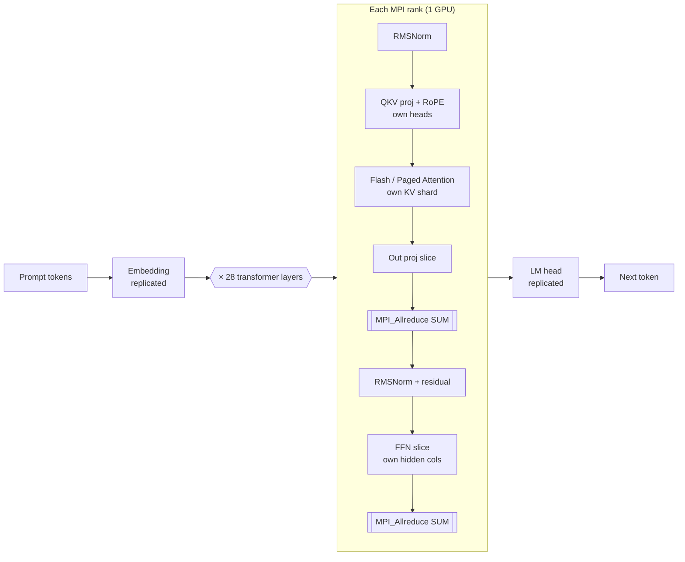
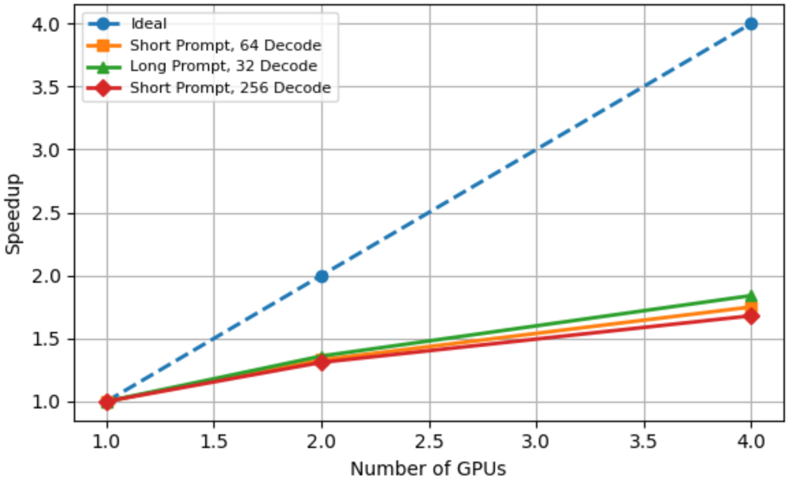
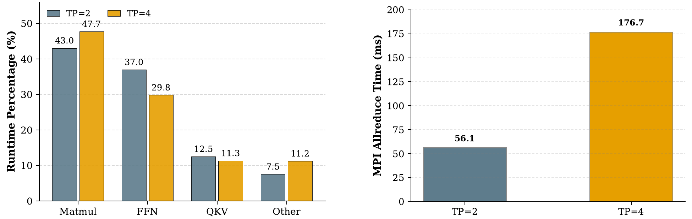

# Distributed LLM Inference with CUDA and MPI

A Llama-3.2-3B inference engine in C++/CUDA, extended with **MPI tensor parallelism**. It runs on CPU (OpenMP), a single GPU, and multiple GPUs. Built on [yalm](https://github.com/andrewkchan/yalm) (see [Acknowledgements](#acknowledgements)).

**Highlights**

- **~97× over 16-thread CPU** on one GPU; **+14.6%** throughput over the yalm CUDA baseline (63.3 → 72.5 tok/s)
- **1.84× strong scaling on 4 GPUs** with 1-D tensor parallelism (up to 143.8 tok/s)
- Custom kernels: **FlashAttention**, **PagedAttention** KV cache, **half2 GEMM**, fused **RMSNorm + residual**, fused **RoPE + QKV**
- Analytical **roofline + ring all-reduce** performance model, checked against **Nsight Systems** profiles

> Joint work with **Xinyu Feng** (Stanford), Spring 2026.

---

## Architecture



**1-D tensor parallelism.** Attention heads, their KV heads, and FFN hidden columns are sharded across ranks. The embedding and LM head are replicated. Each layer needs only **two all-reduces** (after attention and after the FFN) and no point-to-point traffic.

## Optimizations

| Component | Baseline (yalm) | This project |
|---|---|---|
| GEMM / FFN | FP16 matvec | `half2` packed FP16 math, fused FFN kernel |
| Attention | Plain attention, O(heads × seq) scores | FlashAttention with Q/K/V tiles in shared memory |
| KV cache | Contiguous pre-allocated VRAM | Paged fixed-size blocks + PagedAttention, split-K reduction for long contexts |
| RMSNorm | Separate residual add | Vectorized loads, warp-shuffle reduction, residual add fused in |
| RoPE | Separate kernel | In-place, cos/sin in constant memory, fused into QKV projection |
| Multi-GPU | none | MPI tensor parallelism, one rank per GPU |

## Results

Setup: FP16 Llama-3.2-3B-Instruct on NVIDIA Quadro RTX 6000 (24 GB) ×4, NVIDIA HPC SDK.

**Single device**

| Backend | Throughput (tok/s) | Latency (s/tok) | Achieved BW (GB/s) |
|---|---:|---:|---:|
| CPU, OpenMP 16 threads | 0.74 | 1.343 | – |
| CUDA baseline (yalm) | 63.29 | 0.0158 | 457 |
| **CUDA optimized** | **72.54** | **0.0138** | **524** |

**Strong scaling (tensor parallel)**

| Workload | 1 GPU | 2 GPUs | 4 GPUs |
|---|---:|---:|---:|
| Short prompt, 64-token decode | 72.7 tok/s | 96.8 (1.33×) | 127.5 (1.75×) |
| Long prompt, 32-token decode | 78.0 | 106.3 (1.36×) | **143.8 (1.84×)** |
| Short prompt, 256-token decode | 68.7 | 90.0 (1.31×) | 115.5 (1.68×) |

<p align="center"></p>

<p align="center"><br>
<sub>Left: GPU kernel time breakdown. Right: cumulative MPI_Allreduce time (Nsight Systems).</sub></p>

**Why scaling is sub-linear.** In Nsight Systems, GEMM/FFN kernels take about 90% of GPU time. Total `MPI_Allreduce` time grows from 56 ms (TP=2) to 177 ms (TP=4), and per-call latency from 43.6 µs to 137.2 µs. The message size stays fixed at 12 KiB, so **synchronization latency, not bandwidth**, limits scaling. This matches the α-dominated term of the ring all-reduce model.

**Correctness.** CUDA kernels match CPU references (max abs error < 1e-4 for FP32, < 1e-3 for FP16 GEMM/FlashAttention). Greedy decoding produces identical token IDs to the baseline and across TP = 1/2/4 (perplexity Δ < 0.002).

---

## Build & Run

Requirements: a C++20 compiler (GCC ≥ 12), the CUDA toolkit (`nvcc`), and a **CUDA-aware MPI** (e.g. OpenMPI with UCX/CUDA, which ships with the NVIDIA HPC SDK). Python is only needed for weight conversion.

```bash
# 1) Weights: download Llama-3.2-3B-Instruct from Hugging Face (requires accepting Meta's license),
#    then convert to the .yalm format
pip install -r requirements.txt
python convert.py --dtype fp16 llama-3.2-3b-instruct-fp16.yalm /path/to/Llama-3.2-3B-Instruct/

# 2) Build. Set CUARCH for your GPU (sm_75 = Turing / RTX 6000, sm_80 = A100, sm_90 = H100)
make CUARCH=sm_75          # -> build/main
make CUARCH=sm_75 test     # -> build/test

# 3) Run
MODEL=llama-3.2-3b-instruct-fp16.yalm

./build/main $MODEL -i "The capital of France is" -n 64 -t 0.0 -p            # single GPU, greedy, with profiler
OMP_NUM_THREADS=16 ./build/main $MODEL -d cpu -i "The capital of France is" -n 16   # CPU / OpenMP
mpirun -n 4 ./build/main $MODEL -i "The capital of France is" -n 64 -t 0.0 -s 42 -p  # 4-GPU tensor parallel
./build/main $MODEL -m perplexity -i "Some text to score" -p                  # perplexity mode
```

Useful flags: `-d cpu|cuda`, `-m completion|passkey|perplexity`, `-n` decode steps, `-t` temperature (`0.0` = greedy), `-s` seed (fix it for cross-rank checks), `-p` CUDA-event profiler. Run `./build/main -h` for the full list.

**Tests and benchmarks**

```bash
./build/test                    # kernel-vs-CPU correctness tests
./build/test -bk matmul         # per-kernel microbenchmarks: matmul | matmul-wide | mha | ffn
```

**Slurm (4× Quadro RTX 6000 node).** Submit from the repo root:

```bash
sbatch scripts/benchmark.sbatch        # build + tests + single-GPU scenarios
sbatch scripts/tp_benchmark.sbatch     # TP sweep {1,2,4} + scaling summary table
sbatch scripts/tp_correctness.sbatch   # token-exact + perplexity checks across TP sizes
# override the model path with: MODEL=/path/to/model.yalm sbatch ...
```

## Repository layout

```
src/
  infer.cu          # CUDA kernels: half2 GEMM, FlashAttention, PagedAttention, fused RMSNorm/RoPE/FFN
  infer.cpp         # CPU (OpenMP) backend
  dist.{h,cpp}      # MPI tensor-parallel runtime (sharding, CUDA-aware MPI_Allreduce)
  profiler.{h,cu}   # CUDA-event forward-pass profiler (-p)
  model.{h,cpp}     # model config, weight loading / sharding, forward pass
  main.cpp          # CLI: completion / passkey / perplexity modes
  test.cpp          # correctness tests + kernel benchmarks
  sampler, tokenizer, codec, time, debug
vendor/             # fmt, nlohmann/json (header-only deps)
scripts/            # Slurm benchmark and correctness jobs
convert.py          # Hugging Face safetensors -> .yalm
convert_yalm.ipynb  # step-by-step conversion notebook
docs/               # README figures; original yalm README (YALM_README.md)
```

## Future work

Overlapping communication with computation, hierarchical / NCCL collectives, dynamic batching, and multi-node tensor parallelism.

## Acknowledgements

- [yalm](https://github.com/andrewkchan/yalm) by Andrew Chan provided the base C++/CUDA inference framework. See [`docs/YALM_README.md`](docs/YALM_README.md) for the original project README.
- Co-author: **Xinyu Feng**.

Model weights are **not** included. Llama 3.2 is distributed under Meta's Llama 3.2 Community License.
